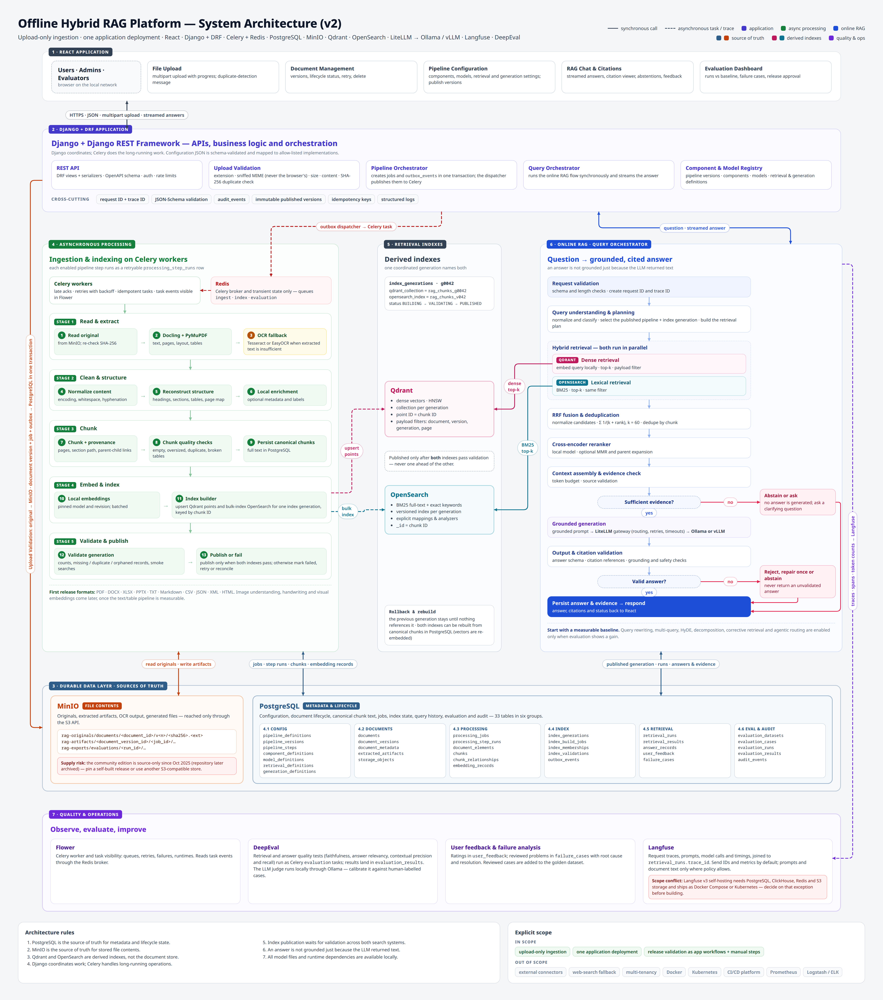
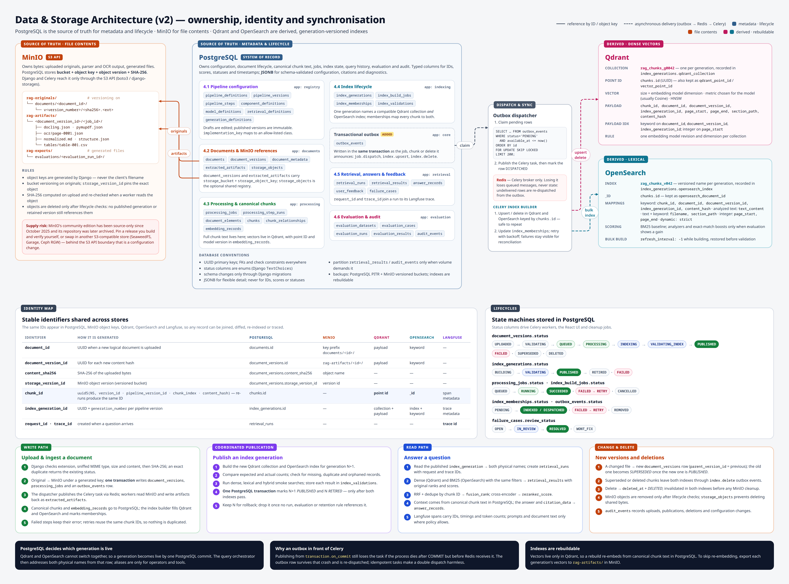
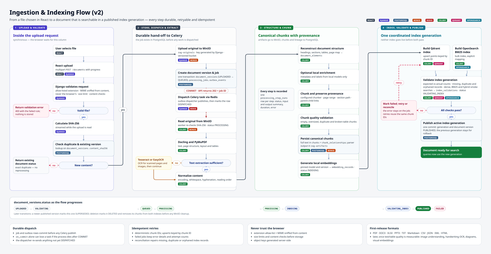
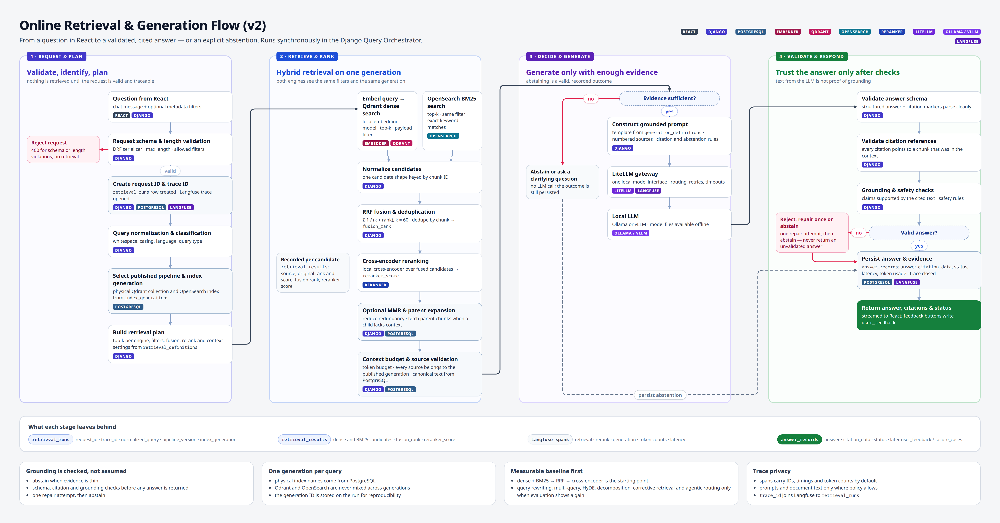
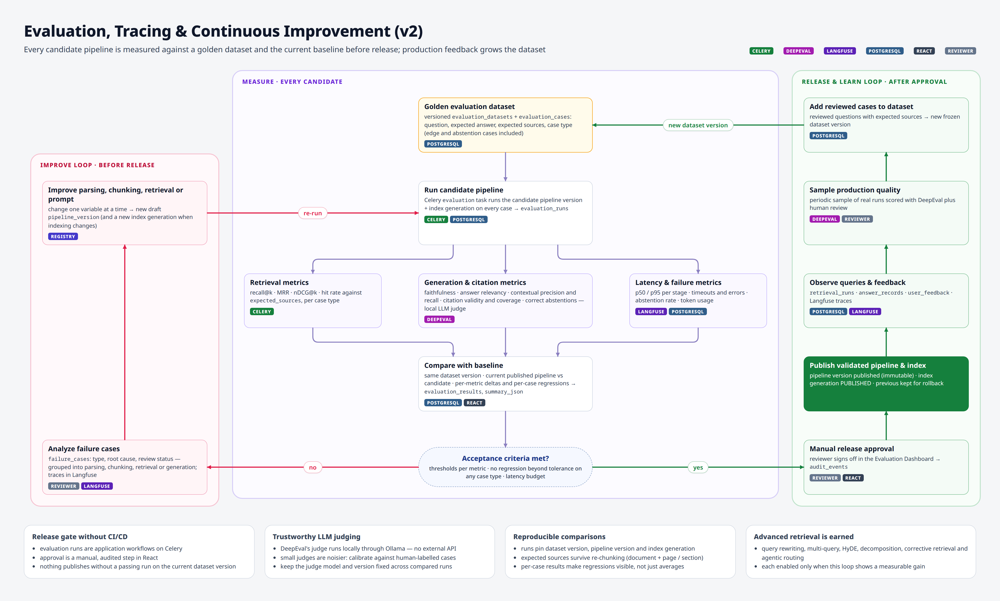

# Offline Hybrid RAG Platform — Architecture (v2)

A configurable, fully local RAG platform. Files are uploaded through React and validated and orchestrated by Django. Celery workers parse, chunk, embed and index them. Questions are answered with hybrid retrieval and grounded, cited generation from local models.

| Layer | Technology | Responsibility |
|---|---|---|
| Frontend | React | Upload, document management, pipeline settings, chat, evaluation UI |
| Application | Django + DRF | APIs, business logic, orchestration |
| System of record | PostgreSQL | Configuration, document lifecycle, chunks, jobs, index state, results |
| Object storage | MinIO (S3 API) | Originals, extracted artifacts, OCR output, generated files |
| Dense retrieval | Qdrant | Vectors, ANN search, payload filters |
| Lexical retrieval | OpenSearch | BM25, full-text and exact keyword search |
| Async execution · broker · monitoring | Celery · Redis · Flower | Parsing, OCR, chunking, embedding, indexing, evaluation |
| LLM gateway · inference | LiteLLM · Ollama or vLLM | One local model interface; local generation |
| Embeddings · reranker | Local embedding model · local cross-encoder | Document and query vectors; candidate reranking |
| Parsing · OCR | Docling + PyMuPDF · Tesseract + EasyOCR | Text, layout, tables; scanned pages |
| Evaluation · tracing | DeepEval · Langfuse | Quality tests; request and model-call traces |

**Scope:**
- **In scope:** upload-only ingestion, one application deployment.
- **Out of scope:** external connectors, web-search fallback, multi-tenancy, Docker, Kubernetes, CI/CD platform, Prometheus, Logstash/ELK.

**Rules:**
1. PostgreSQL is the source of truth for metadata and lifecycle state.
2. MinIO is the source of truth for file contents.
3. Qdrant and OpenSearch are derived indexes.
4. Django coordinates; Celery runs the long work.
5. Publication waits for both search systems to pass validation.
6. An LLM's text is not proof of grounding.
7. Everything runs from locally available files.

---

## Diagrams

### 1. System architecture


The seven groups from the brief, laid out so their lines don't cross. Django sits above three columns: Celery processing, the two derived indexes, and the online RAG flow. Below them are the durable data layer and then quality & operations.

### 2. Data & storage architecture


- **What each store owns:** the MinIO bucket and key layout, the PostgreSQL table groups (4.1–4.6), the outbox → Redis → Celery dispatch path, and the Qdrant and OpenSearch collection/index specs.
- **Identity map:** which ID appears in which store, including Langfuse.
- **Status lifecycles.**
- **Four paths:** write, publish, read, and change/delete.

### 3. PostgreSQL schema


The brief's section 4 as 33 tables and 39 foreign keys, with columns, types, nullability, keys and the recommended indexes. Additions beyond the brief are highlighted in the image: **+** marks added columns, **ADDED** marks an added table.

### 4. Ingestion & indexing flow


### 5. Online retrieval & generation flow


### 6. Evaluation & continuous improvement loop


---

## Findings that change the plan

These came from checking each new component against the brief's constraints (offline, no Docker, one deployment).

1. **MinIO community edition is no longer distributed as binaries.** Since October 2025 it has been source-only, and its repository was later archived. Existing deployments keep working, but patches aren't shipped. Options:
   - pin a release you build and verify yourself, or
   - use another S3-compatible store (SeaweedFS, Garage, Ceph RGW).

   Keep Django and Celery on the S3 API (boto3 / django-storages) so the swap is a configuration change.
2. **Langfuse v3 conflicts with "no Docker".** Self-hosted v3 needs PostgreSQL, ClickHouse, Redis/Valkey and S3 blob storage, plus separate web and worker processes. It is shipped as Docker Compose (single VM, no high availability or backups) or Kubernetes (Helm). Decide before building:
   - allow a container exception for Langfuse only,
   - run it from source with its own ClickHouse (unsupported path), or
   - start with traces in PostgreSQL (`retrieval_runs.trace_id`, latencies, token usage) and add Langfuse later.

   Langfuse's S3 store could be a separate MinIO bucket.
3. **Dispatching Celery tasks from `transaction.on_commit` can lose tasks.** If the process dies after COMMIT but before Redis receives the task, the task is gone. The design adds an `outbox_events` table, written in the same transaction as the job or chunk rows:
   - a dispatcher claims rows with `SELECT … FOR UPDATE SKIP LOCKED` and publishes them;
   - tasks are idempotent, so a double dispatch is harmless.

   This implements the brief's "transactional outbox or durable dispatch mechanism".
4. **DeepEval works offline.** Its LLM judge can be a local Ollama model. Small judges are noisier, so:
   - calibrate the judge against human-labelled cases;
   - keep the judge model fixed across compared runs.

## Additions to the brief's schema

| Addition | Why |
|---|---|
| `pipeline_versions.retrieval_definition_id`, `.generation_definition_id` | The brief defines both tables, but nothing references them. A run must record which retrieval and generation settings it used. |
| `chunks.pipeline_version_id` | Re-processing one document version with a new pipeline would otherwise collide on `(document_version_id, chunk_index)`. The unique key becomes `(document_version_id, pipeline_version_id, chunk_index)`. |
| `processing_jobs.created_at`, `retrieval_runs.created_at` | The brief's recommended indexes use these columns. |
| `outbox_events` table | Durable Celery dispatch and index sync (finding 3). |

Two further recommendations:
- **Chunk IDs:** `uuid5(namespace, document_version_id · pipeline_version_id · chunk_index · content_hash)`, used directly as the Qdrant point ID and the OpenSearch `_id`. Qdrant accepts only UUIDs or unsigned integers as point IDs. Retries then produce the same IDs, so they never duplicate records.
- **Which generation is live:** decided by one PostgreSQL commit (`index_generations.status = PUBLISHED`). Qdrant and OpenSearch can each switch an alias atomically, but not both together. So the query path reads the physical collection and index names from PostgreSQL; aliases are for operators only.

## Index publication sequence

1. Build the new Qdrant collection and OpenSearch index for the generation.
2. Compare expected and actual chunk counts.
3. Check for missing, duplicate and orphaned records.
4. Run representative dense, lexical and hybrid searches; record the results in `index_validations`.
5. Mark the generation published only after both indexes pass.
6. Keep the previous generation for rollback until nothing references it.

## Retrieval order (baseline)

1. Qdrant dense search and OpenSearch BM25 search, in parallel.
2. Normalize and dedupe the candidates.
3. RRF fusion (k = 60).
4. Cross-encoder reranking.
5. Optional MMR and parent expansion.
6. Context budget.
7. Source and evidence validation.
8. Grounded generation through LiteLLM.
9. Schema, citation and grounding checks, or abstain.

Query rewriting, multi-query, HyDE, decomposition, corrective retrieval and agentic routing are enabled only when the evaluation loop shows a gain.

---

## Files

```
docs/
├── README.md
├── images/                    # rendered PNGs (2× scale)
│   ├── 01-system-architecture.png
│   ├── 02-database-architecture.png
│   ├── 03-database-schema.png
│   ├── 04-ingestion-flow.png
│   ├── 05-query-flow.png
│   └── 06-evaluation-loop.png
├── src/                       # editable sources
│   ├── 01…06 *.html           # diagram pages (03 is generated)
│   ├── build_schema.py        # table spec → 03-database-schema.html
│   ├── _schema-template.html  # ER page shell + FK line router
│   ├── diagram.css · flow.css · diagram.js
│   ├── viewer.js              # browser view: fit to window, wheel zoom, drag to pan
│   ├── render-dot.mjs         # Graphviz via WebAssembly (when dot/neato is not installed)
│   └── render.py              # HTML → PNG with Playwright
```

**Viewing in a browser:** open any `docs/src/0*.html` page. It opens fitted to 100% of the window width and height, with no scrollbars.

| Action | Control |
|---|---|
| Zoom at the cursor | mouse wheel |
| Pan | drag |
| Toggle fit / actual size | double-click |
| Fit · actual size · zoom | keys `0` · `1` · `+` / `-`, or the toolbar at the bottom right |

To regenerate:

```bash
pip install playwright && playwright install chromium
cd docs/src && npm i @hpcc-js/wasm-graphviz && cd -   # only if Graphviz is not installed
python3 docs/src/build_schema.py    # after editing TABLES / EDGES / LAYOUT
python3 docs/src/render.py          # all images; or e.g. `render.py 03`
```

## Sources

- MinIO community edition becomes source-only — https://linuxiac.com/minio-with-yet-another-controversial-move/ · https://itsfoss.com/news/minio-moves-away-from-open-source/ · https://glukhov.org/data-infrastructure/object-storage/minio-dead/
- Langfuse self-hosting (architecture, Docker Compose vs Kubernetes) — https://langfuse.com/self-hosting · https://langfuse.com/self-hosting/docker · https://langfuse.com/self-hosting/deployment/infrastructure/clickhouse · https://langfuse.com/changelog/2024-12-09-Langfuse-v3-stable-release
- Outbox vs `on_commit` publishing (Open edX ADR) — https://docs.openedx.org/projects/openedx-events/en/ulmo/decisions/0015-outbox-pattern-and-production-modes.html
- DeepEval with a local Ollama judge — https://docs.atla-ai.com/integrations/deepeval · https://transformerlab.ai/docs/evaluate/judge
- Qdrant collection aliases — https://qdrant.tech/documentation/manage-data/collections/ · hybrid queries — https://qdrant.tech/documentation/concepts/hybrid-queries
- OpenSearch reciprocal rank fusion — https://docs.opensearch.org/latest/vector-search/ai-search/hybrid-search/rrf/
- Docling technical report — https://arxiv.org/html/2408.09869v5
